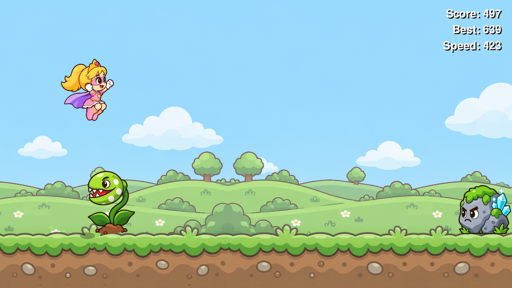
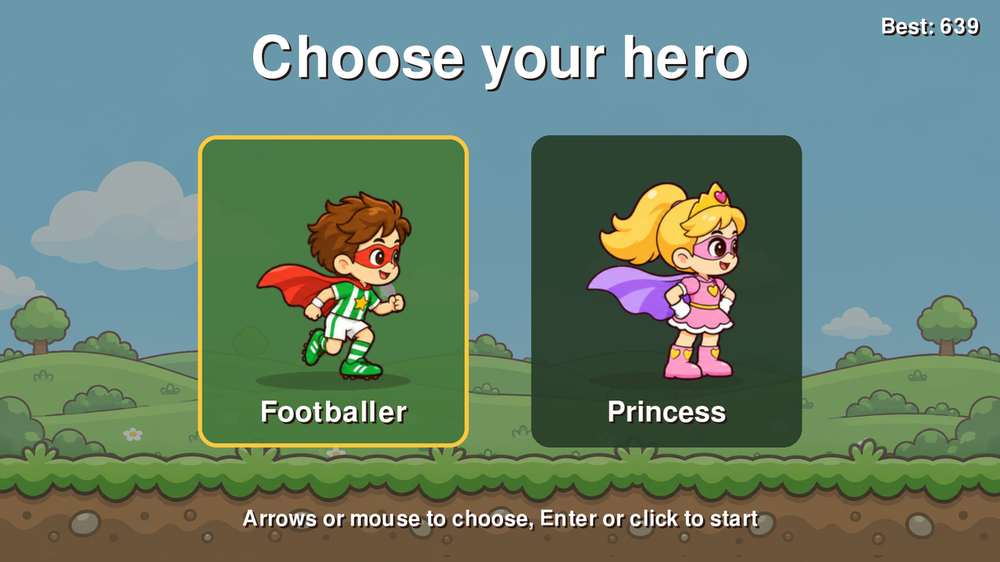

# run-simulator



A cartoon 2D endless runner in its own window. The Footballer or the Princess runs from left to right and jumps over three kinds of carnivorous plants, a tree stump, a cactus and a mossy boulder while the speed grows smoothly. Every obstacle has its own crash scene. Rendering runs on the GPU with vsync (120 FPS on 120 Hz displays).



## Controls

- Hero selection: ←/→ arrows or mouse hover; Enter or a click on the card starts the run.
- Run: Space to jump.
- After a crash, once the 1.2 s crash scene ends: Space to run again with the same hero; Enter or the "Change hero" button returns to hero selection.
- Quit: close the window.

## Requirements

- Python 3.13+
- [uv](https://docs.astral.sh/uv/)

## Install

```bash
uv sync
```

## Run

```bash
uv run run-simulator
```

```bash
uv run python -m run_simulator
```

## Checks

```bash
uv run pytest
uv run ruff check .
uv run ruff format --check .
uv run mypy
```

## Art

All raster assets were generated by `gpt-image` through Codex CLI (signed in with ChatGPT, no API key); the UI is drawn in code.

- `art/style.md` — the style block and hero and obstacle descriptions included in every prompt.
- `art/jobs.json` — generation jobs (built by `tools/art_jobs.py`); `art/prompts.md` — log of every prompt and file.
- `art/raw/` — original generations, never overwritten.
- `art/manifest.json` — which animation strips become which sprites and their in-game sizes.

Generating missing strips and post-processing (`#FF00FF` chroma key, slicing strips into frames, bottom-center alignment, seamless tiles):

```bash
uv run python tools/gen_batch.py
uv run python tools/process_art.py
```
